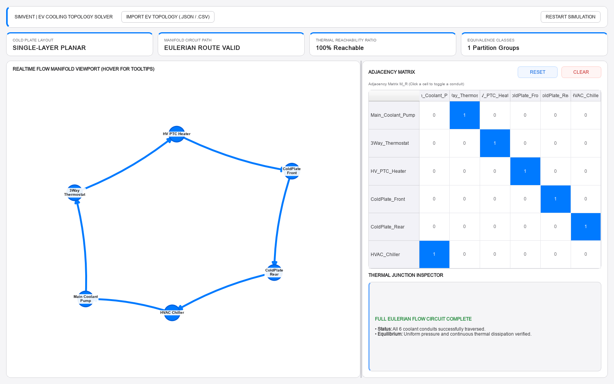
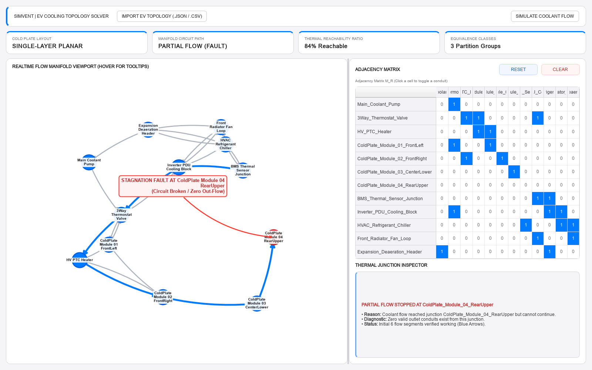

# SIMVENT | EV Cooling Topology Solver

SIMVENT is a browser application for exploring directed EV coolant-manifold topologies. It displays the network and adjacency matrix together, analyzes connectivity properties, and animates a coolant route or highlights a dead-end fault.

> **Scope:** This is a graph-topology demonstrator, not a CFD solver or a quantitative thermal/vehicle model. The bundled Tata-labeled examples are illustrative and are not OEM-validated engineering data.

## Screenshots

| Topology and completed flow | Dead-end fault detection |
| --- | --- |
|  |  |

## Features

- Interactive directed manifold graph with node selection, hover details, zoom, and node repositioning.
- Editable adjacency matrix: toggle individual conduits, reset to the imported topology, or clear the network.
- Summary metrics for graph planarity, Eulerian route validity, reachability, and equivalence groups.
- Step-by-step flow visualization, with a diagnostic when flow reaches a junction with no outlet.
- Import JSON topologies, CSV adjacency matrices, and CSV edge lists.

## Requirements and setup

Python 3.10 or later is recommended. Install the dependencies listed in `requirements.txt` and launch the app:

```powershell
python -m venv .venv
.\.venv\Scripts\Activate.ps1
python -m pip install -r requirements.txt
streamlit run app.py
```

The application opens in your browser.
The project pins Streamlit to a light theme so the matrix stays consistent with the dashboard in dark-mode browsers.

## Using the application

1. Start with the built-in six-junction example, or select **IMPORT EV TOPOLOGY** to load a file.
2. Click a matrix cell to add or remove a directed conduit. Use **RESET** to restore the current imported topology or **CLEAR** to remove all conduits.
3. Click a graph node to inspect its inlet/outlet counts and reachable junctions. Hover over nodes and conduits for details, and zoom or pan the viewport.
4. Choose **SIMULATE COOLANT FLOW** to animate the route and inspect the resulting status.

## Bundled examples

| File | Example |
| --- | --- |
| `tata.csv` | Connected 12-junction topology |
| `tata_f.csv` | Fault example with a dead end at the rear cold-plate junction |

Despite the `.csv` suffix, both bundled files contain JSON. The importer detects their content automatically, so select them directly in the application.

## Input formats

- **JSON:** An object with an `adjacency_matrix` field and an optional `node_labels` object keyed by zero-based node index.
- **CSV adjacency matrix:** A square matrix of `0` and `1` values; optional row/column labels are supported.
- **CSV edge list:** Source and destination columns, with an optional header (for example, `source,destination`).

For all formats, the matrix must be non-empty and square, and its values must be `0` or `1`.
